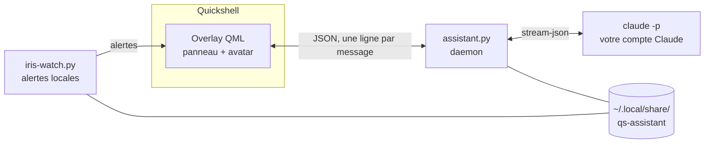

# Iris

**Assistante personnelle pour Quickshell, propulsée par Claude Code.**

[](https://github.com/mincozz/Iris/actions/workflows/ci.yml)
[](LICENSE)


Français · [English](docs/README.en.md)

Iris est un panneau de chat intégré à la barre de votre shell [Quickshell](https://quickshell.org). Elle pilote la CLI [Claude Code](https://claude.com/claude-code) de **votre** compte Claude : chaque utilisateur utilise son propre abonnement, et aucune donnée ne transite par un serveur du projet.

> Projet indépendant, non affilié à Anthropic. « Claude » est une marque d'Anthropic.

<!-- Capture d'écran : déposez docs/screenshot.png, puis décommentez les lignes suivantes.
<p align="center"></p>
-->

## Sommaire

[Aperçu](#aperçu) · [Démarrage rapide](#démarrage-rapide) · [Prérequis](#prérequis) · [Installation](#installation) · [Utilisation](#utilisation) · [Alertes](#alertes-et-résumé-du-matin) · [Mise à jour](#mise-à-jour) · [Configuration](#configuration) · [Architecture](#architecture) · [Sécurité](#sécurité) · [Limites](#limites-connues) · [Développement](#développement) · [Licence](#licence)

## Aperçu

| | |
|---|---|
| **Conversation** | Chat dans la barre, avec accès à votre PC (fichiers, commandes en lecture seule, informations système) et, si vous avez activé les connecteurs Claude, à votre agenda, vos mails, Notion et Drive. Réponses rapides par défaut, modèle plus puissant pour le code. |
| **Autorisations** | Lire est libre. Tout ce qui modifie quelque chose affiche une carte **Autoriser / Refuser** avec le contenu exact qui serait écrit. |
| **Alertes** | Sans quota Claude : `git pull` à faire (avec bouton), travail non poussé, rappels d'agenda, disque, batterie, services en échec, mises à jour d'Iris, plus un **résumé du matin**. |
| **Raccourcis** | `SUPER + I` envoie le texte sélectionné à Iris ; `SUPER + SHIFT + I` le joint pour que vous tapiez une consigne (« traduis », « explique »…). |
| **Rangement** | Analyse un dossier, propose un plan, l'applique en une validation, et tout s'annule. |
| **Skills** | Vos propres recettes en Markdown pour les tâches récurrentes. |
| **Mémoire** | Ce qu'Iris sait de vous reste dans un fichier local que vous pouvez lire et éditer. |
| **Langues** | Français et anglais (interface, prompt, alertes). |
| **Maintenance** | Mise à jour en un clic (bouton ⬇) et diagnostic en lecture seule (`iris-doctor`). |

## Démarrage rapide

```bash
git clone https://github.com/mincozz/Iris.git && cd Iris
./install.sh --dry-run   # voir ce qui sera fait, sans rien modifier
./install.sh             # installer (quelques questions)
```

Puis rechargez Quickshell et testez :

```bash
qs ipc call assistant toggle
~/.config/quickshell/scripts/iris-doctor
```

Vous pouvez aussi laisser un assistant de code faire l'installation : lancez-le dans le dépôt et demandez-lui « installe Iris » ([AGENTS.md](AGENTS.md) décrit la procédure).

## Prérequis

| | Requis | Rôle |
|---|---|---|
| Système | Linux, compositeur Wayland, [Quickshell](https://quickshell.org) | Hôte du panneau. Hyprland est conseillé (flou, raccourcis) mais facultatif. |
| Outils | Python 3.9+, `git` | Daemon, alertes, mise à jour. |
| Compte | CLI `claude` **connectée** | Lancez `claude` une fois pour vous connecter. |
| Facultatifs | `wl-clipboard`, `libnotify`, `glib2` (`gio`), Nautilus (sinon `xdg-open`) | Raccourcis, notifications, corbeille du rangement, ouverture des fichiers. |
| Thème | Un objet `theme` dans votre `shell.qml` | Champs attendus : `bg, fg, ff, fs, primary, secondary, tertiary, lavender, light, outline, txt2, error, warn`. [`test/shell.qml`](test/shell.qml) en fournit un minimal. |

## Installation

```bash
./install.sh [options]
```

| Option | Effet |
|---|---|
| `--dry-run` | Montre les actions sans rien écrire |
| `--prefix DIR` | Autre dossier Quickshell (défaut : `~/.config/quickshell`) |
| `-y` | Sans question : garde les défauts et les options données |
| `--language fr\|en\|auto` | Langue d'Iris (par défaut d'après `$LANG`) |
| `--name NOM` | Comment Iris vous appelle |
| `--deny-read "~/.ssh,~/.gnupg"` | Dossiers que `Read` et les commandes de lecture ne peuvent pas ouvrir |
| `--fast-model ID` / `--power-model ID` | Modèles utilisés |
| `--ask-key` / `--ask-edit-key` | Touches des deux raccourcis (défaut `SUPER + I` / `SUPER + SHIFT + I`) |
| `--no-hypr` | Ne touche pas à la configuration Hyprland |
| `--reconfigure` | Refait `config.json` (sinon il est conservé) |
| `--uninstall` | Retire Iris (vos données restent dans `~/.local/share/qs-assistant/`) |

Dans un terminal, l'installateur pose quatre questions : la langue, votre prénom, l'interdiction de lire `~/.ssh` et `~/.gnupg` (oui par défaut) et le choix des modèles.

**Ce qu'il fait** : vérifie les prérequis, copie les fichiers (une sauvegarde `.iris-bak` est créée pour tout fichier remplacé), crée `~/.local/share/qs-assistant/` (mémoire, `config.json`, `watch.json`, recettes d'exemple, jamais écrasés), câble `shell.qml` dans un bloc balisé, ajoute la règle de flou et les deux raccourcis à `hyprland.lua`, puis lance le diagnostic. Il est relançable sans risque.

**Restent à faire à la main**, car ils dépendent de votre shell (facultatifs) : le bouton d'avatar dans la barre ([`integration/Bar.qml.snippet`](integration/Bar.qml.snippet)) et le clic sur une alerte qui ouvre le panneau ([`integration/NotificationToast.qml.snippet`](integration/NotificationToast.qml.snippet)).

## Utilisation

**Panneau.** `qs ipc call assistant toggle|open|close` l'ouvre et le ferme ; `qs ipc call assistant ask "…"` envoie un message. En-tête : historique (avec un champ de recherche qui filtre à chaque lettre, sans tenir compte des accents ni de la casse), nouvelle conversation et bouton de mise à jour. Le sélecteur Auto / Rapide / Puissant choisit le modèle.

**Raccourcis.** `scripts/iris-ask` envoie la sélection (à défaut le presse-papiers) ; avec `--edit`, il la **joint** au panneau (pastille « Texte joint », retirable) et vous tapez votre consigne avant d'envoyer. `IRIS_ASK_DRY=1` montre ce qui partirait, sans rien envoyer. Le texte part tel quel à Claude : ne l'utilisez pas sur un mot de passe.

**Skills.** Une recette est un fichier `~/.local/share/qs-assistant/skills/nom.md` :

```markdown
---
description: Prépare mon rapport hebdo (« rapport de la semaine »)
---
1. Liste mes commits des 7 derniers jours : `git -C <dépôt> log --since="7 days ago" --oneline`.
2. Réponds par 2 à 4 puces par projet, puis une phrase de synthèse.
```

Iris reçoit la liste (nom et description) et lit la recette quand votre demande y correspond, ou quand vous écrivez `/nom`. Noms de fichier simples (lettres, chiffres, `-`, `_`, `.`), 30 recettes au plus. Des exemples dans votre langue sont copiés à l'installation, sans jamais écraser les vôtres. La liste est lue au début d'une conversation : ouvrez une nouvelle conversation après avoir ajouté une recette. Une recette n'a aucun droit supplémentaire : les actions qui modifient demandent toujours votre clic.

**Images.** Copiez une capture d'écran (par exemple `grim -g "$(slurp)" - | wl-copy`) puis **Ctrl+V** dans le panneau : une pastille « Image jointe » (retirable) apparaît et l'image part avec votre prochain message ; Iris la lit avec `Read`. PNG de 10 Mo au plus, copiée dans `~/.local/share/qs-assistant/attachments/` (droits `0600`) et supprimée au bout de 7 jours. Le collage de texte ne change pas.

**Rappels.** « Rappelle-moi dans 20 min d'appeler Alex » : Iris lance `iris-remind add` (une carte Autoriser / Refuser montre le rappel) et `iris-watch` vous prévient à l'heure, dans le panneau et par notification. Rappels uniques, un an au plus, 50 en attente au plus, stockés dans `~/.local/share/qs-assistant/reminders.json`. Un rappel manqué parce que le PC était éteint part au prochain démarrage, avec l'heure prévue. Pour en annuler un, demandez-le à Iris.

**Rangement.** Demandez à Iris de ranger un dossier : elle l'analyse (`organize.py scan`), propose un plan, l'applique en une seule validation, et `organize.py undo` annule le dernier rangement. Rien n'est écrasé, la corbeille passe par `gio trash`.

## Alertes et résumé du matin

`iris-watch.py` tourne avec le panneau et écrit à Iris sans consommer de quota Claude (seule la lecture de l'agenda via les connecteurs en utilise). Réglages dans `~/.local/share/qs-assistant/watch.json` (modèle : [`integration/watch.example.json`](integration/watch.example.json)).

| Alerte | Quand |
|---|---|
| Dépôt en retard | `git fetch` régulier ; bouton **Faire le git pull** (`--ff-only`, limité à votre dossier personnel) |
| Travail non sauvegardé | Le soir, à partir de `unpushed_hour` |
| Agenda | `remind_minutes` avant chaque événement |
| Santé du PC | Disque presque plein, batterie faible, services en échec, mises à jour en attente |
| Mise à jour d'Iris | Toutes les 6 h ; bouton **Mettre à jour** |
| Rappel | À l'heure demandée (`iris-remind`), vérifié toutes les 30 s |
| Résumé du matin | Une fois par jour à partir de `morning_hour` : agenda du jour et travail git resté en plan |

| Clé | Rôle |
|---|---|
| `morning_hour` | Heure du résumé (défaut 8), `null` pour le couper |
| `calendar_via_claude` | `false` : Claude ne lit jamais votre agenda (seul `ics_url` sert) |
| `ics_url` | Adresse iCal secrète de votre agenda (aucun quota) |
| `timezone` | Fuseau IANA, par exemple `America/New_York` ; vide = celui de la machine |
| `check_updates` | `false` pour couper les alertes de mise à jour |
| `remind_minutes`, `unpushed_hour`, `repo_roots`, `exclude` | Rappels d'agenda, heure de l'alerte git du soir, dossiers scannés |

Test : `python3 scripts/iris-watch.py --once morning`.

## Mise à jour

```bash
~/.config/quickshell/scripts/iris-update          # ou le bouton ⬇ du panneau, ou en demandant à Iris de se mettre à jour
~/.config/quickshell/scripts/iris-update --check  # voir s'il y a du nouveau, sans rien changer
```

L'installateur retient où est votre clone et quelle version il a installée. `iris-update` couvre deux cas : le remote a avancé (il fait `git pull --ff-only` dans le clone) ou le clone est plus récent que l'installation (tiré à la main, ou poussé depuis ce clone). Dans les deux cas il relance l'installation avec votre config, conservée. Un clone modifié ne bloque que le `git pull`. Gardez le clone en place ; les fichiers installés sont remplacés, donc personnalisez via `config.json` ou `prompt_file`.

Le bouton ne passe pas par Claude (aucun quota) ; le panneau peut se recharger à la fin, et un message confirme le résultat.

## Configuration

`~/.local/share/qs-assistant/config.json` : toutes les clés sont facultatives ; une valeur invalide est ignorée avec un message sur stderr.

| Clé | Rôle |
|---|---|
| `language` | `fr` (défaut), `en` ou `auto` (suit `$LANG`). `IRIS_LANG=en` l'emporte sur le fichier |
| `user_name` | Comment Iris vous appelle |
| `models` | `fast` et `power` : modèles utilisés (défaut Haiku / Sonnet) |
| `session_idle_minutes` | Inactivité avant une nouvelle conversation (défaut 30) |
| `prompt_file` | Chemin d'un prompt à vous, à la place de `assistant-prompt.md` |
| `deny_read_paths` | Dossiers que `Read`/`Grep`/`Glob` et `cat`/`head`/`tail`/`less`/`grep` ne peuvent pas lire, défaut `~/.ssh`, `~/.gnupg`, `~/.aws` (`[]` pour tout autoriser). Toute commande qui cite ces chemins est refusée. Au mieux, ce n'est pas un bac à sable |
| `extra_readonly_commands` | Commandes lancées sans demander : à vous de vous assurer qu'elles n'ont aucun effet de bord |
| `extra_denied_commands` | Commandes refusées même avec un clic |
| `agent` | `claude` (défaut) ou le nom d'une entrée de `agents` |
| `agents` | Vos propres agents, voir ci-dessous |

**Autre agent que Claude.** Déclarez n'importe quelle CLI qui répond sur stdout :

```json
{
  "agent": "gemini",
  "agents": {
    "gemini": { "command": ["gemini", "-p", "{prompt}"] },
    "ollama": { "command": ["ollama", "run", "{model}"],
                "models": { "fast": "llama3.2", "power": "qwen2.5-coder" } }
  }
}
```

`{prompt}` et `{model}` sont remplacés ; sans `{prompt}`, le prompt arrive sur stdin. La commande est lancée une fois par message, avec l'historique récent (`history`, 8 par défaut). Le prompt est court par défaut (le prompt complet décrit des outils que l'agent n'a pas et ralentit un modèle local) : `prompt_file` dans l'agent le remplace. Limites : pas de cartes Autoriser / Refuser, pas d'outils d'Iris (agenda, mails, fichiers) ni de jauge de quota, et les outils éventuels de l'agent suivent ses propres règles, pas celles d'Iris. Si le nom est inconnu, Iris retombe sur `claude`.

**Changer d'agent depuis le panneau.** Dès que `agents` contient une entrée, une pastille avec le nom de l'agent apparaît dans l'en-tête : un clic ouvre la liste (`claude` et vos agents). Le choix est mémorisé dans `~/.local/share/qs-assistant/agent` et l'emporte sur `agent` de `config.json`, qui n'est jamais modifié. Changement refusé pendant qu'Iris répond ; la conversation continue (le nouvel agent reçoit l'historique récent en texte).

**Mémoire.** Iris lit `~/.local/share/qs-assistant/memory.md` et le met à jour quand vous lui demandez de retenir quelque chose, avec une demande d'autorisation. Un modèle vide est fourni dans [`integration/memory.example.md`](integration/memory.example.md). Historique, mémoire et agenda restent dans `~/.local/share/qs-assistant/` et ne sont jamais versionnés.

**Prompts.** [`assistant-prompt.md`](scripts/assistant-prompt.md) (français) et [`assistant-prompt.en.md`](scripts/assistant-prompt.en.md) sont à adapter à votre goût, ou remplacez-les via `prompt_file`.

## Architecture



L'overlay lance le daemon et le moniteur d'alertes comme processus fils. Le daemon garde un `claude -p` ouvert en flux, choisit le modèle, transmet les demandes d'autorisation au panneau et n'exécute que ce que vous validez.

| Chemin | Rôle |
|---|---|
| `overlays/AssistantOverlay.qml` | Panneau de chat « liquid glass » |
| `overlays/AssistantAvatar.qml` | Avatar animé (humeur : idle, thinking, talking) |
| `scripts/assistant.py` | Daemon : pont overlay ↔ `claude -p`, permissions, historique, actions des boutons |
| `scripts/assistant-prompt.md`, `.en.md` | Prompt système (français, anglais) |
| `scripts/iris-watch.py` | Alertes locales et résumé du matin |
| `scripts/organize.py` | Rangement de dossiers : `scan`, `apply`, `undo` |
| `scripts/iris-ask` | Raccourci : envoie ou joint la sélection |
| `scripts/iris-update`, `scripts/iris-doctor` | Mise à jour et diagnostic |
| `scripts/i18n.py` | Choix de la langue partagé par les scripts |
| `integration/` | Extraits à greffer, exemples de configuration et de recettes |
| `test/` | Shell minimal, test de bout en bout, tests du daemon |
| `docs/` | Version anglaise du README et journal des changements |

## Sécurité

Iris lance `claude` avec vos droits.

- Lire des fichiers et lancer des commandes en lecture seule se fait sans demander ; **tout le reste** passe par Autoriser / Refuser, avec le contenu qui serait écrit.
- `sudo`, `su`, `doas`, `dd`, `mkfs` et `wipefs` sont refusés.
- Le contenu des mails, pages web et fichiers est traité comme des **données**, pas des ordres.
- Les boutons d'alerte n'exécutent que des actions connues (`update`, `git_pull`), arguments vérifiés côté daemon.
- Les données restent dans un dossier en droits 700 ; la CI scanne les secrets (Gitleaks).

Aucun assistant qui lit du contenu externe n'est à l'abri d'une injection de prompt : gardez un œil sur les cartes d'autorisation. Modèle complet et signalement d'une faille : [SECURITY.md](.github/SECURITY.md).

## Limites connues

- Conçu et testé sur Arch Linux + Hyprland + Quickshell ; ailleurs, l'installateur et `iris-doctor` indiquent ce qui manque, mais le bouton de barre, le flou et les raccourcis sont à adapter.
- Chaque message consomme le quota de votre abonnement Claude.
- Agenda, mails, Notion et Drive passent par les connecteurs de votre compte Claude ; sans eux, Iris ne les voit pas (l'agenda peut aussi venir d'une adresse iCal).
- Le panneau envoie du texte et des images collées (PNG, `wl-clipboard` requis), pas de voix pour l'instant. Les images ne passent qu'avec l'agent `claude`.

## Développement

```bash
test/test-e2e.sh --no-gui    # installe dans /tmp, vérifie, désinstalle ; ne touche pas à votre config
```

Ce test ne touche ni votre shell, ni vos données, ni votre compte Claude (`--with-claude` l'autorise explicitement pour un message minuscule). La CI lance ShellCheck, la compilation Python, ce test et Gitleaks. Les conventions (textes via `pick()` / `overlay.tr()`, aucune donnée personnelle, un test par changement) et la procédure de pull request sont dans [CONTRIBUTING.md](.github/CONTRIBUTING.md) ; l'historique des changements dans [CHANGELOG.md](docs/CHANGELOG.md).

## Licence

[MIT](LICENSE). Les contributions sont acceptées sous la même licence.
