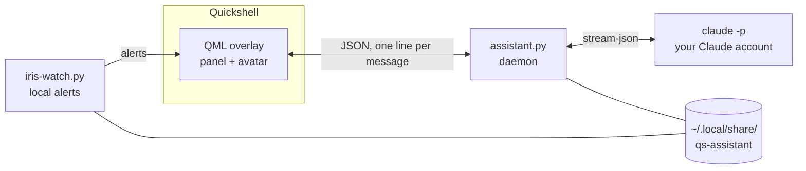

# Iris

**A personal assistant for Quickshell, powered by Claude Code.**

[](https://github.com/mincozz/Iris/actions/workflows/ci.yml)
[](../LICENSE)


[Français](../README.md) · English

Iris is a chat panel built into the bar of your [Quickshell](https://quickshell.org) shell. By default it drives the [Claude Code](https://claude.com/claude-code) CLI on **your** Claude account (every user uses their own subscription), or another CLI of your choice such as Ollama. No data goes through a project server.

> Independent project, not affiliated with Anthropic. "Claude" is a trademark of Anthropic.

<!-- Screenshot: drop screenshot.png next to this file, then uncomment the following lines.
<p align="center"></p>
-->

## Contents

[Overview](#overview) · [Quick start](#quick-start) · [Requirements](#requirements) · [Installation](#installation) · [Usage](#usage) · [Alerts](#alerts-and-morning-brief) · [Updating](#updating) · [Configuration](#configuration) · [Architecture](#architecture) · [Security](#security) · [Known limits](#known-limits) · [Development](#development) · [License](#license)

## Overview

| | |
|---|---|
| **Conversation** | Chat in the bar, with access to your PC (files, read-only commands, system info) and, if you enabled the Claude connectors, your calendar, mail, Notion and Drive. Fast replies by default, a more powerful model for code. |
| **Agents** | Claude by default; you can add Ollama, Gemini or any CLI and switch between them with one click in the panel. The installer downloads your Ollama models. |
| **Search** | Find an old conversation by typing a few letters (accents and case ignored). |
| **Reminders** | "Remind me in 20 min…": an alert on time, even if the PC was off at that moment. |
| **Images** | Paste a screenshot with Ctrl+V: Iris reads it. |
| **Permissions** | Reading is free. Anything that changes something shows an **Allow / Deny** card with the exact content that would be written. |
| **Alerts** | No Claude quota: `git pull` to do (with a button), unpushed work, calendar reminders, disk, battery, failed services, Iris updates, plus a **morning brief**. |
| **Shortcuts** | `SUPER + I` sends the selected text to Iris; `SUPER + SHIFT + I` attaches it so you type an instruction ("translate", "explain"…). |
| **Tidying** | Analyses a folder, proposes a plan, applies it with one approval, and everything can be undone. |
| **Skills** | Your own Markdown recipes for recurring tasks. |
| **Memory** | What Iris knows about you stays in a local file you can read and edit. |
| **Languages** | French and English (interface, prompt, alerts). |
| **Maintenance** | One-click update (⬇ button) and a read-only diagnostic (`iris-doctor`). |

## Quick start

```bash
git clone https://github.com/mincozz/Iris.git && cd Iris
./install.sh --dry-run   # see what will be done, nothing is changed
./install.sh             # install (a few questions)
```

Then reload Quickshell and try:

```bash
qs ipc call assistant toggle
~/.config/quickshell/scripts/iris-doctor
```

You can also let a coding assistant do the install: run it in the repository and ask "install Iris" ([AGENTS.md](../AGENTS.md), in French, describes the procedure).

## Requirements

| | Required | Purpose |
|---|---|---|
| System | Linux, a Wayland compositor, [Quickshell](https://quickshell.org) | Hosts the panel. Hyprland is recommended (blur, shortcuts) but optional. |
| Tools | Python 3.9+, `git` | Daemon, alerts, updating. |
| Account | The `claude` CLI, **logged in** | Run `claude` once to sign in. |
| Optional | `wl-clipboard`, `libnotify`, `glib2` (`gio`), Nautilus (otherwise `xdg-open`) | Shortcuts, notifications, trash for tidying, opening files. |
| Theme | A `theme` object in your `shell.qml` | Expected fields: `bg, fg, ff, fs, primary, secondary, tertiary, lavender, light, outline, txt2, error, warn`. [`test/shell.qml`](../test/shell.qml) provides a minimal one. |

## Installation

```bash
./install.sh [options]
```

| Option | Effect |
|---|---|
| `--dry-run` | Shows the actions without writing anything |
| `--prefix DIR` | Another Quickshell folder (default `~/.config/quickshell`) |
| `-y` | No questions: keeps the defaults and the given options |
| `--language fr\|en\|auto` | Iris's language (defaults from `$LANG`) |
| `--name NAME` | What Iris calls you |
| `--deny-read "~/.ssh,~/.gnupg"` | Folders `Read` and the read commands may not open |
| `--fast-model ID` / `--power-model ID` | Claude models used |
| `--ollama-model ID` | Declares the `ollama` agent with this model and downloads what is missing (`ollama pull`). Repeatable: the 1st is the fast model, the 2nd the powerful one |
| `--add-agent "name=command"` | Declares another CLI (e.g. `"gemini=gemini -p {prompt}"`); the installer never runs the command. Repeatable |
| `--no-pull` | Declares Ollama models without downloading them |
| `--ask-key` / `--ask-edit-key` | Keys of the two shortcuts (default `SUPER + I` / `SUPER + SHIFT + I`) |
| `--no-hypr` | Leaves the Hyprland configuration alone |
| `--reconfigure` | Redoes `config.json` (otherwise it is kept) |
| `--uninstall` | Removes Iris (your data stays in `~/.local/share/qs-assistant/`) |

In a terminal the installer asks a few questions: the language, your first name, whether to forbid reading `~/.ssh` and `~/.gnupg` (yes by default), which Claude models to use, then whether to add a local agent (Ollama) and another agent (Gemini, Codex…). With `-y` or outside a terminal it keeps the defaults and **downloads nothing**, unless `--ollama-model` is given explicitly. The agent options also work on an existing `config.json` (only the `agents` keys are merged, an agent already declared is kept). Output is coloured in a terminal, plain with `NO_COLOR=1` or outside one.

**What it does**: checks the requirements, copies the files (a `.iris-bak` backup is made for any replaced file), creates `~/.local/share/qs-assistant/` (memory, `config.json`, `watch.json`, example recipes, never overwritten), declares your agents and downloads your Ollama models if you asked, wires `shell.qml` in a marked block, adds the blur rule and the two shortcuts to `hyprland.lua`, then runs the diagnostic. It is safe to re-run. The installer's own messages are in French.

**Left to do by hand**, because they depend on your shell (optional): the avatar button in the bar ([`integration/Bar.qml.snippet`](../integration/Bar.qml.snippet)) and clicking an alert to open the panel ([`integration/NotificationToast.qml.snippet`](../integration/NotificationToast.qml.snippet)).

## Usage

**Panel.** `qs ipc call assistant toggle|open|close` opens and closes it; `qs ipc call assistant ask "…"` sends a message. Header: an agent pill (shown once you have declared a second agent), history (grouped by day, with a search field that filters as you type, ignoring accents and case), new conversation and the update button. The Auto / Fast / Powerful selector picks the model. Three animated dots show that Iris has not started answering yet.

**Shortcuts.** `scripts/iris-ask` sends the selection (the clipboard if nothing is selected); with `--edit` it **attaches** it to the panel (an "Attached text" pill, removable) and you type your instruction before sending. `IRIS_ASK_DRY=1` shows what would be sent without sending anything. The text goes to Claude as is: don't use it on a password.

**Skills.** A recipe is a file `~/.local/share/qs-assistant/skills/name.md`:

```markdown
---
description: Prepare my weekly report ("weekly report")
---
1. List my commits from the last 7 days: `git -C <repo> log --since="7 days ago" --oneline`.
2. Answer with 2 to 4 bullets per project, then a one-sentence summary.
```

Iris gets the list (name and description) and reads a recipe when your request matches it, or when you type `/name`. Plain file names (letters, digits, `-`, `_`, `.`), 30 recipes at most. Examples in your language are copied at install time, never overwriting yours. The list is read when a conversation starts: open a new conversation after adding a recipe. A recipe gets no extra permissions: actions that change something still ask for your click.

**Images.** Copy a screenshot (for example `grim -g "$(slurp)" - | wl-copy`) then press **Ctrl+V** in the panel: an "Attached image" pill (removable) appears and the image goes with your next message; Iris reads it with `Read`. PNG, 10 MB at most, copied to `~/.local/share/qs-assistant/attachments/` (mode `0600`) and deleted after 7 days. Pasting text is unchanged.

**Reminders.** "Remind me in 20 min to call Alex": Iris runs `iris-remind add` (an Allow / Deny card shows the reminder) and `iris-watch` alerts you on time, in the panel and by notification. One-shot reminders, one year ahead at most, 50 pending at most, stored in `~/.local/share/qs-assistant/reminders.json`. A reminder missed while the PC was off is sent at the next start, with its due time. Ask Iris to cancel one.

**Tidying.** Ask Iris to tidy a folder: she analyses it (`organize.py scan`), proposes a plan, applies it with a single approval, and `organize.py undo` reverts the last tidy-up. Nothing is overwritten, and the trash goes through `gio trash`.

## Alerts and morning brief

`iris-watch.py` runs with the panel and writes to Iris without using Claude quota (only reading the calendar through the connectors does). Settings are in `~/.local/share/qs-assistant/watch.json` (template: [`integration/watch.example.json`](../integration/watch.example.json)).

| Alert | When |
|---|---|
| Repository behind | Regular `git fetch`; **Run git pull** button (`--ff-only`, limited to your home folder) |
| Unsaved work | In the evening, from `unpushed_hour` |
| Calendar | `remind_minutes` before each event |
| PC health | Disk almost full, low battery, failed services, pending updates |
| Iris update | Every 6 hours; **Update now** button |
| Reminder | At the requested time (`iris-remind`), checked every 30 s |
| Morning brief | Once a day from `morning_hour`: today's agenda and git work left unsaved |

| Key | Purpose |
|---|---|
| `morning_hour` | Brief time (default 8), `null` to turn it off |
| `calendar_via_claude` | `false`: Claude never reads your calendar (only `ics_url` is used) |
| `ics_url` | Secret iCal address of your calendar (no quota) |
| `timezone` | IANA zone, e.g. `America/New_York`; empty = the machine's zone |
| `check_updates` | `false` to turn off update alerts |
| `remind_minutes`, `unpushed_hour`, `repo_roots`, `exclude` | Calendar reminders, evening git alert time, scanned folders |

Test: `python3 scripts/iris-watch.py --once morning`.

## Updating

```bash
~/.config/quickshell/scripts/iris-update          # or the ⬇ button in the panel, or by asking Iris to update herself
~/.config/quickshell/scripts/iris-update --check  # see if there is something new, change nothing
```

The installer remembers where your clone is and which version it installed. `iris-update` covers two cases: the remote moved (it runs `git pull --ff-only` in the clone) or the clone is newer than the installation (pulled by hand, or pushed from that clone). Either way it re-runs the installation with your config, which is kept. A modified clone only blocks the `git pull`. Keep the clone in place; installed files are replaced, so customise through `config.json` or `prompt_file`.

The button does not go through Claude (no quota); the panel may reload at the end, and a message confirms the result.

## Configuration

`~/.local/share/qs-assistant/config.json`: every key is optional; an invalid value is ignored with a message on stderr.

| Key | Purpose |
|---|---|
| `language` | `fr` (default), `en` or `auto` (follows `$LANG`). `IRIS_LANG=en` overrides the file |
| `user_name` | What Iris calls you |
| `models` | `fast` and `power`: models used (default Haiku / Sonnet) |
| `session_idle_minutes` | Idle time before a fresh conversation (default 30) |
| `prompt_file` | Path to your own prompt instead of `assistant-prompt.md` |
| `deny_read_paths` | Folders `Read`/`Grep`/`Glob` and `cat`/`head`/`tail`/`less`/`grep` can't read, default `~/.ssh`, `~/.gnupg`, `~/.aws` (`[]` allows everything). Any command naming these paths is refused. Best effort, not a sandbox |
| `extra_readonly_commands` | Commands run without asking: make sure they have no side effects |
| `extra_denied_commands` | Commands refused even with a click |
| `agent` | `claude` (default) or the name of an entry in `agents` |
| `agents` | Your own agents, see below |

**An agent other than Claude.** Simplest: `./install.sh --ollama-model llama3.2 --ollama-model qwen2.5-coder` (declares the agent and downloads the models) or `./install.sh --add-agent "gemini=gemini -p {prompt}"`. By hand, declare any CLI that answers on stdout:

```json
{
  "agent": "gemini",
  "agents": {
    "gemini": { "command": ["gemini", "-p", "{prompt}"] },
    "ollama": { "command": ["ollama", "run", "{model}"],
                "models": { "fast": "llama3.2", "power": "qwen2.5-coder" } }
  }
}
```

`{prompt}` and `{model}` are substituted; without `{prompt}` the prompt goes to stdin. The command runs once per message with the recent history (`history`, default 8). The prompt is short by default (the full one describes tools the agent lacks and slows a local model down): `prompt_file` in the agent replaces it. Limits: no Allow / Deny cards, none of Iris's tools (calendar, mail, files) and no quota gauge, and any tools the agent has follow its own rules, not Iris's. An unknown name falls back to `claude`.

**Switching agent from the panel.** As soon as `agents` has an entry, a pill with the agent's name shows in the header: click it to open the list (`claude` and your agents). The choice is kept in `~/.local/share/qs-assistant/agent` and wins over `agent` in `config.json`, which is never modified. Switching is refused while Iris is replying; the conversation goes on (the new agent receives the recent history as text).

**Memory.** Iris reads `~/.local/share/qs-assistant/memory.md` and updates it when you ask her to remember something, with an authorisation request. An empty template is in [`integration/memory.example.md`](../integration/memory.example.md). History, memory and calendar stay in `~/.local/share/qs-assistant/` and are never versioned.

**Prompts.** [`assistant-prompt.md`](../scripts/assistant-prompt.md) (French) and [`assistant-prompt.en.md`](../scripts/assistant-prompt.en.md) are yours to adapt, or replace them with `prompt_file`.

## Architecture



The overlay starts the daemon and the alert watcher as child processes. The daemon keeps a `claude -p` open as a stream, picks the model, forwards permission requests to the panel and only runs what you approve.

| Path | Role |
|---|---|
| `overlays/AssistantOverlay.qml` | "Liquid glass" chat panel |
| `overlays/AssistantAvatar.qml` | Animated avatar (mood: idle, thinking, talking) |
| `scripts/assistant.py` | Daemon: overlay ↔ `claude -p` bridge, permissions, history, button actions |
| `scripts/assistant-prompt.md`, `.en.md` | System prompt (French, English) |
| `scripts/iris-watch.py` | Local alerts and morning brief |
| `scripts/organize.py` | Folder tidying: `scan`, `apply`, `undo` |
| `scripts/iris-ask` | Shortcut: sends or attaches the selection |
| `scripts/iris-remind` | One-shot reminders: `add`, `cancel`, `due` (`iris-watch` calls `due`) |
| `scripts/iris-update`, `scripts/iris-doctor` | Updating and diagnostic |
| `scripts/i18n.py` | Language choice shared by the scripts |
| `integration/` | Snippets to graft, example config and recipes |
| `test/` | Minimal shell, end-to-end test, daemon, reminder, image, search and agent tests |
| `specs/`, `tasks/` | Feature specifications and plans (method: spec, plan, tasks, code) |
| `docs/` | English README and changelog |

## Security

Iris runs `claude` with your rights.

- Reading files and running read-only commands needs no confirmation; **everything else** goes through Allow / Deny, showing the content that would be written.
- `sudo`, `su`, `doas`, `dd`, `mkfs` and `wipefs` are refused.
- The content of mails, web pages and files is treated as **data**, not orders.
- Alert buttons only run known actions (`update`, `git_pull`), with arguments checked by the daemon.
- Pasted images are checked (PNG signature, 10 MB), copied with mode 600 into `attachments/` and deleted after 7 days; what they show is data, not orders.
- Reminders go through an Allow / Deny card (`iris-remind add`); their text is neutralised when displayed and never executed.
- Switching agent only accepts `claude` and the names declared in `config.json`; the installer never runs an agent's command.
- Data lives in a mode-700 folder; CI scans for secrets (Gitleaks).

No assistant that reads external content is immune to prompt injection: keep an eye on the permission cards. Full model and how to report a vulnerability: [SECURITY.md](../.github/SECURITY.md) (French).

## Known limits

- Built and tested on Arch Linux + Hyprland + Quickshell; elsewhere the installer and `iris-doctor` tell you what is missing, but the bar button, blur and shortcuts need adapting.
- Every message uses your Claude subscription quota.
- Calendar, mail, Notion and Drive come through your Claude account's connectors; without them Iris can't see them (the calendar can also come from an iCal address).
- The panel sends text and pasted images (PNG, needs `wl-clipboard`), no voice yet. Images only work with the `claude` agent.

## Development

```bash
test/test-e2e.sh --no-gui    # installs into /tmp, checks, uninstalls; leaves your config alone
```

This test touches neither your shell, nor your data, nor your Claude account (`--with-claude` explicitly allows it for one tiny message). CI runs ShellCheck, Python compilation, the daemon tests (`test-agent`, `test-agent-switch`, `test-security`, `test-search`, `test-remind`, `test-image`, none needing a Claude account), this test and Gitleaks. Conventions (strings through `pick()` / `overlay.tr()`, no personal data, a test per change) and the pull-request process are in [CONTRIBUTING.md](../.github/CONTRIBUTING.md); the history of changes is in [CHANGELOG.md](CHANGELOG.md).

## License

[MIT](../LICENSE). Contributions are accepted under the same license.
